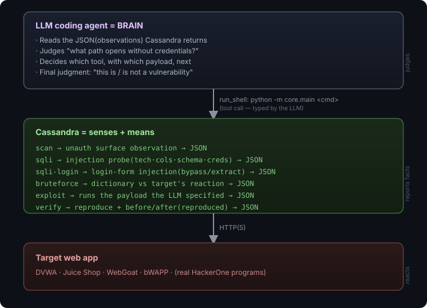

<p align="center"></p>

# Cassandra

[한국어](README.md) · [English](README.en.md)

**A black-box web vulnerability finder using a small LLM model (27B-class).**

Built with the [Qwen3.8 27B Abliterated model](https://huggingface.co/huihui-ai/Huihui-Qwen3.8-27B-abliterated) and the [Stewart executor](https://github.com/midopa-dept/stewart).

Cassandra does not make decisions on its own. It is designed as a **toolset for an LLM coding agent**. When the agent calls `python -m core.main <command>` via `run_shell`, Cassandra sends and receives HTTP traffic and returns the result as **JSON**. It reports *observations* only — "there is a form here", "putting `'` in this parameter raises an error", "this API returns 200 with no token". The *judgment* — *"not knowing the credentials, what path opens it? registration? SQLi login bypass? IDOR?"* — is made by the brain, i.e. the **LLM agent**.

The verification process used the same model and executor as the build process.

---

## Results (2026-11-16)

Measured results from running the **observe → judge → attempt → confirm** loop on four benchmarks, under the premise of **not knowing the credentials in advance (black-box)**:

| Benchmark | Entry path found by the LLM (black-box) | Finding · confirmation |
|-----------|----------------------------------------|------------------------|
| **DVWA** | Unauth scan → login-form **bruteforce**(dictionary) → `admin/password` | **SQLi**(UNION, 5 credentials+MD5 extracted)·**XSS reflected** — verify **confirmed** |
| **Juice Shop** | API endpoints extracted from JS bundle → **self-registration**(`/api/Users/`) | **IDOR**: customer token reads all 51 users (incl. admin) from `authentication-details/` — verify **confirmed** |
| **WebGoat** | Registration form → **self-account** → traced RequireJS to lesson endpoint | **XSS reflected**(`CrossSiteScripting/attack5a`) — verify **confirmed** |
| **bWAPP** | Login form leaks a hint("bee/bug") itself → **brute** | **SQLi**(error-based)·**XSS reflected** — verify **confirmed** |

**Principle — No Default Credentials.** We do not do reward-hacking by web-searching "what are this app's default credentials?". Instead we (1) read only what the target **itself exposes**(form hints, robots.txt, JS bundles, error messages), and (2) throw a dictionary at it and confirm by **the target's reaction**(redirect / status code).

---

## Architecture — Brain(LLM) + Senses(Cassandra)

The single most important thing to understand about Cassandra: **it is not "a bot that finds bugs on its own when you run it."** It separates a person's senses from their brain.



**Why split it this way.**

- **Cassandra(senses) does not judge.** It fires HTTP, analyzes the returned bytes, and passes back *facts* as JSON. "This param is injectable=True", "this response contains `<script>alert(1)</script>`", "this API returns 401". If you put judgment in, it over-fits to one app and stops working on a new one.
- **The LLM(brain) judges.** It reads Cassandra's JSON and does exactly the reasoning a human security professional does in their head: *"There's a login form but I don't know the credentials. Is there a registration flow? If not, SQLi login bypass, or pull the credential DB."* Then it executes that judgment as the next `run_shell` command.
- **The human supervises.** They approve the LLM's judgment and Cassandra's evidence.

This separation is what makes Cassandra **generalize**. It is not code tuned to DVWA; it is the structure of "a tool that reports observations well + a brain that judges", so it can run the same loop on a real website it has never seen.

### Following one loop, concretely

When a person tells the LLM agent *"find vulnerabilities on http://localhost:8081"*, this is what happens:

```
Human : find vulnerabilities on http://localhost:8081

LLM   : [run_shell] python -m core.main scan http://localhost:8081 --max-pages 25
Cassandra → { pages:[...], forms:[{action:/login.php, fields:[username,password,...]}], ... }

LLM   : (judgment) A login form is visible. I don't know the credentials.
        The page may give a hint, or I can brute with a dictionary.
        [run_shell] python -m core.main bruteforce http://localhost:8081 \
                     --login-url /login.php --users admin --passwords password,admin --max-attempts 200
Cassandra → { success:true, username:"admin", password:"password", evidence:"redirect → index.php" }

LLM   : (judgment) In as admin/password. Scan the interior for SQLi/XSS candidates.
        [run_shell] python -m core.main sqli ".../sqli/?id=1" --login-user admin ...
Cassandra → { verdict:"sql_injection", technique:"union", users:[{user:admin, password_md5:...}, ...] }

LLM   : (judgment) Pulled the credential DB via UNION. Let me also confirm XSS.
        [run_shell] python -m core.main verify ".../xss_r/?name=<script>..." \
                     --expected "alert(1)" --baseline-url ".../xss_r/"
Cassandra → { reproduced:true, verdict_hint:"confirmed", diff:"..." }

LLM   : (final) Confirmed SQLi(UNION, 5 credentials) + XSS reflected. Report.
```

At every step **Cassandra reports facts only, the LLM judges only**. That is what "brain + senses" means.

---

## Observe → Judge → Attempt → Confirm

The four stages that generalize the loop above.

1. **Observe** (`scan`) — reports the unauth surface(pages, forms, hidden fields, API endpoints in JS bundles, headers, errors) and, after auth, the interior. **It does not judge.**
2. **Judge** (LLM) — reads the observations and picks an attack path. Order: (a) what is open unauthenticated → (b) create your own account(registration) → (c) password reset(token leak/prediction) → (d) login-form injection(SQLi bypass, credential DB extraction) → (e) after auth(IDOR, privilege escalation).
3. **Attempt** (`sqli` / `sqli-login` / `bruteforce` / `exploit`) — executes the path the LLM chose.
4. **Confirm** (`verify`) — **reproduces** the finding and captures the before(normal) vs after(vulnerable) response diff, returning `reproduced: true/false`. The human makes the final call.

---

## Usage

### With an LLM agent (primary use)

Cassandra is intended as a **tool for an LLM coding agent**(stewart, Claude Code, etc.). The agent calls the CLI below via `run_shell` and reads the JSON output to make the next judgment.

```bash
# ① Observe — unauth surface(pages·forms·JS API·headers·errors)
python -m core.main scan http://localhost:8081 --max-pages 25

#    To see the interior too, add login options (only credentials the target exposes)
python -m core.main scan http://localhost:8081 \
    --login-url /login.php --login-user admin --login-pass password

# ③ Attempt
#    Automatic SQLi probe (technique·columns·schema·credential DB)
python -m core.main sqli "http://localhost:8081/vulnerabilities/sqli/?id=1" \
    --login-url /login.php --login-user admin --login-pass password

#    Login-form SQLi (bypass/extract without credentials)
python -m core.main sqli-login http://localhost:8081 --login-url /login.php

#    Login bruteforce (dictionary vs the target's reaction)
python -m core.main bruteforce http://localhost:8082 \
    --login-url /login.php --users admin,root --passwords password,admin,123456 --max-attempts 200

#    Run the payload the LLM specified (POST body·custom headers)
python -m core.main exploit "http://localhost:8082/htmli_get.php?firstname=%3Cscript%3Ealert(1)%3C%2Fscript%3E" \
    -i "XSS reflected in firstname"

# ④ Confirm — reproduce + before/after evidence
python -m core.main verify "http://localhost:8082/sqli_1.php?title=a%27&action=search" \
    -i "SQLi error-based: single quote breaks query" \
    --expected "You have an error in your SQL" \
    --baseline-url "http://localhost:8082/sqli_1.php?title=a&action=search" \
    --login-url /login.php --login-user bee --login-pass bug
```

Every command returns **JSON** on stdout. The LLM can read it directly, and a human can pipe it through `| jq`.

### By hand (demo / debugging)

You can run every command directly, without an agent. Just type the commands above into a terminal.

### Bringing up the benchmarks

```bash
cd demo && docker compose up -d
# DVWA: http://localhost:8081   Juice Shop: http://localhost:3000
# bWAPP: http://localhost:8082  WebGoat: http://localhost:8083/WebGoat
```

bWAPP needs its DB installed on first visit via `/install.php?install=yes`.

---

## Installation

```bash
# Requires Python 3.11+
uv sync

# Playwright (optional, screenshots)
uv run playwright install chromium

# Nuclei (optional)
brew install nuclei   # or https://nuclei.projectdiscovery.io/
```

Copy `.env.example` to `.env` and fill in API keys (`.env` is gitignored). Set scan options·LLM·scheduler·dashboard port in `config.yaml`.

---

## Scanner modules — what they observe

`scanner/` are the concrete sensors of the ① observe stage. Each module discriminates by **universal signals**(no hard-coded app names).

| Module | Observes |
|--------|----------|
| `sqli.py` | SQL injection (boolean / time-based blind / union / error) |
| `xss.py` | Reflected XSS, **DOM XSS**(JS bundle sink+source), **Stored XSS**(stored→reflected) |
| `idor.py` | IDOR (access with another user's ID) |
| `ssrf.py` | SSRF |
| `auth.py` | Auth bypass (HTTP method override, etc.) |
| `fuzz.py` | Anomaly detection (status-code change) |
| `cve.py` | CVE matching (tech detection + NVD) |
| `api.py` | REST API (auth, rate limit, body injection) |
| `file.py` | File upload RCE, path traversal |
| `session.py` | **Weak Session**, **Insecure CAPTCHA**, **Password Reset** |
| `context.py` | Extract API endpoints from JS bundles (for SPAs) |
| `login.py` | Login / session handling |
| `web.py` | **orchestrator** — calls all of the above |

Example: `session.py`'s **Weak Session** repeatedly requests an endpoint, collects the Set-Cookie values, and reports "predictable session" if the cookie is *reissued every time, sequentially numbered(1,2,3,4), low-entropy*. It does not hard-code a cookie name.

---

## Structure

```
cassandra/
├── core/          # models, config, db, scheduler, logger, main (CLI)
├── scanner/       # ① observe: sqli, xss, idor, ssrf, auth, fuzz, cve, api,
│                  #   file, session, infra, logic, nuclei, login, context + web.py
├── exploit/       # ③ attempt: executor(sqli_probe, sqli_login_probe), bruteforce, poc
├── verify/        # ④ confirm: evidence (reproduce + before/after)
├── asset/         # asset discovery (CT, DNS, API crawl, CVE, rescan, scope)
├── triage/        # dedup, poc (LLM judgment·report is done by the agent)
├── web/           # dashboard
├── demo/          # docker-compose (DVWA + Juice Shop + bWAPP + WebGoat)
├── tests/         # integration tests
└── docs/          # logo, VULN_REPORT, walkthrough, agent_prompts
```

## Tests

```bash
python tests/test_mvp.py          # MVP
python tests/test_asset.py        # asset discovery
python tests/test_stage3.py       # scanner expansion + daemon
python tests/test_dvwa_login.py   # DVWA login
python tests/test_8c_multistep.py # multi-step flow
python tests/test_live.py         # DVWA + Juice Shop live
```

## Docs

- [`docs/VULN_REPORT.md`](docs/VULN_REPORT.md) — what was actually found, exploit measurements, known-vulnerability comparison
- [`docs/walkthrough.md`](docs/walkthrough.md) — code explanation ("why built this way")
- [`docs/agent_prompts.md`](docs/agent_prompts.md) — prompts the LLM agent uses when calling Cassandra
- [`PLAN.md`](PLAN.md) — full plan (North Star, stages)
- [`HANDOFF.md`](HANDOFF.md) — current state · progress · next steps

## License

[MIT](LICENSE) — Copyright (c) 2026 Junha Kang

Uses [Qwen3.8-27B](https://huggingface.co/Qwen/Qwen3.8-27B) (Apache-2.0) as the LLM backend.
