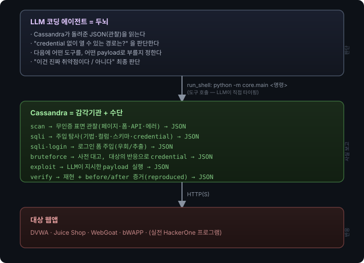

<p align="center"></p>

# Cassandra

**처음 보는(알지 못하는) 웹사이트에서 취약점을 찾아내는 블랙박스 보안 도구.**

Cassandra는 혼자 판단하지 않습니다. **LLM 코딩 에이전트의 도구(toolset)**로 설계됐습니다 — 에이전트가 `run_shell`로 `python -m core.main <명령>`을 호출하면, Cassandra는 HTTP 트래픽을 주고받아 그 결과를 **JSON**으로 돌려줍니다. "여기에 폼이 있다", "이 파라미터에 `'`를 넣으면 에러가 난다", "이 API가 토큰 없이도 200을 준다"는 **관찰**만 보고합니다. 그 관찰을 읽고 *"credential을 모른 상태에서 열 수 있는 경로는 등록? SQLi 로그인 우회? IDOR?"*을 **판단**하는 것은 두뇌, 즉 **LLM 에이전트**입니다.

---

## 성과 (2026-11-16)

4개 벤치마크에서, **credential을 미리 알지 않는(블랙박스)** 전제로, LLM이 Cassandra의 관찰을 읽으며 **관찰 → 판단 → 시도 → 확인** 루프를 돌린 실측 결과입니다.

| 벤치마크 | LLM이 찾은 진입 경로(블랙박스) | 발견·확인 |
|----------|-------------------------------|-----------|
| **DVWA** | 무인증 scan → 로그인 폼 **bruteforce**(사전)로 `admin/password` | **SQLi**(UNION, 5명 credential+MD5 추출)·**XSS reflected** — verify **confirmed** |
| **Juice Shop** | JS 번들에서 API 엔드포인트 추출 → **자기 등록**(`/api/Users/`) | **IDOR**: customer 토큰으로 `authentication-details/`에서 51명 전체(admin 포함) — verify **confirmed** |
| **WebGoat** | registration 폼 → **자기 계정 등록** → RequireJS 추적해 lesson endpoint | **XSS reflected**(`CrossSiteScripting/attack5a`) — verify **confirmed** |
| **bWAPP** | login 폼이 스스로 힌트("bee/bug")를 노출 → **브루트** | **SQLi**(error-based)·**XSS reflected** — verify **confirmed** |

**원칙 — Default Credential 금지.** "이 앱의 기본 계정은?"을 웹에서 검색해 답을 가져오는 보상해킹을 하지 않습니다. 대신 (1) 대상이 **스스로 공개하는 것**(폼 힌트, robots.txt, JS 번들, 에러 메시지)만 읽고, (2) 사전(dictionary)을 대고 **대상의 반응**(리다이렉트·상태코드)으로 확인합니다.

---

## 아키텍처 — 두뇌(LLM) + 감각기관(Cassandra)

Cassandra를 이해하는 가장 중요한 것 하나: **이것은 "실행하면 알아서 버그를 찾는 자동화 봇"이 아닙니다.** 사람의 감각기관과 두뇌를 분리해서 본 것입니다.



**왜 이렇게 나누는가.**

- **Cassandra(감각기관)는 판단하지 않습니다.** HTTP를 날리고, 받은 바이트를 분석해서 *사실*만 JSON으로 넘깁니다. "이 파라미터가 injectable=True", "이 응답에 `<script>alert(1)</script>`가 있다", "이 API가 401을 준다". 판단을 넣으면 특정 앱에 맞춰 과최적화되고, 새 웹사이트에서 안 먹힙니다.
- **LLM(두뇌)이 판단합니다.** Cassandra의 JSON을 읽고, 사람 보안 전문가가 머릿속으로 하는 것과 똑같은 추론을 합니다: *"로그인 폼이 있는데 credential을 몰라. 등록 플로우가 있나? 없으면 SQLi로 로그인 우회, 아니면 credential DB를 뽑자."* 그리고 그 판단을 `run_shell`의 다음 명령으로 실행합니다.
- **사람은 감독자입니다.** LLM의 판단과 Cassandra의 증거를 보고 최종 승인합니다.

이 분리가 Cassandra를 **일반화**되게 합니다. DVWA에 맞춘 코드가 아니라, "관찰을 잘 보고하는 도구 + 판단하는 두뇌"라는 구조이기 때문에, 본 적이 없는 실제 웹사이트에서도 같은 루프로 돌릴 수 있습니다.

### 한 루프를 실제로 따라가기

사람이 LLM 에이전트에게 *"http://localhost:8081에서 취약점 찾아봐"*라고 하면, 이런 흐름이 됩니다:

```
사람  : http://localhost:8081 취약점 찾아봐

LLM   : [run_shell] python -m core.main scan http://localhost:8081 --max-pages 25
Cassandra → { pages:[...], forms:[{action:/login.php, fields:[username,password,...]}], ... }

LLM   : (판단) 로그인 폼이 보인다. credential을 몰라.
        페이지가 힌트를 주거나, 사전으로 브루트할 수 있다.
        [run_shell] python -m core.main bruteforce http://localhost:8081 \
                     --login-url /login.php --max-attempts 200
Cassandra → { success:true, username:"admin", password:"password", evidence:"redirect → index.php" }

LLM   : (판단) admin/password로 들어갔다. 내부 스캔해서 SQLi/XSS 후보를 본다.
        [run_shell] python -m core.main sqli ".../sqli/?id=1" --login-user admin ...
Cassandra → { verdict:"sql_injection", technique:"union", users:[{user:admin, password_md5:...}, ...] }

LLM   : (판단) UNION으로 credential DB를 뽑았다. XSS도 확인해보자.
        [run_shell] python -m core.main verify ".../xss_r/?name=<script>..." \
                     --expected "alert(1)" --baseline-url ".../xss_r/"
Cassandra → { reproduced:true, verdict_hint:"confirmed", diff:"..." }

LLM   : (최종) SQLi(UNION, credential 5명) + XSS reflected 확인. 보고서.
```

매 단계에서 **Cassandra는 사실만, LLM은 판단만** 합니다. 이것이 "두뇌 + 감각기관"이라는 뜻입니다.

---

## 관찰 → 판단 → 시도 → 확인

위 루프를 일반화한 4단계입니다.

1. **관찰** (`scan`) — 무인증 표면(페이지, 폼, hidden 필드, JS 번들의 API 엔드포인트, 헤더, 에러)과, 인증 후 내부를 보고합니다. **판단하지 않습니다.**
2. **판단** (LLM) — 관찰을 읽고 공격 경로를 정합니다. 순서: (a) 무인증으로 열려 있는 것 → (b) 자기 계정 만들기(등록) → (c) 비밀번호 재설정(토큰 유출/예측) → (d) 로그인 폼 주입(SQLi 우회, credential DB 추출) → (e) 인증 후(IDOR, 권한 상승).
3. **시도** (`sqli` / `sqli-login` / `bruteforce` / `exploit`) — LLM이 정한 경로를 실행합니다.
4. **확인** (`verify`) — 찾은 것을 **재현**하고 before(정상) vs after(취약) 응답 차이를 캡처해 `reproduced: true/false`를 줍니다. 사람이 최종 판단합니다.

---

## 사용

### LLM 에이전트와 함께 (주된 용도)

Cassandra는 **LLM 코딩 에이전트(stewart, Claude Code, etc.)의 도구**로 intended됩니다. 에이전트가 `run_shell`로 아래 CLI를 호출하고, JSON 출력을 읽어서 다음 판단을 합니다.

```bash
# ① 관찰 — 무인증 표면(페이지·폼·JS API·헤더·에러)
python -m core.main scan http://localhost:8081 --max-pages 25

#    인증 후 내부도 보려면 로그인 옵션 (대상이 공개하는 credential만)
python -m core.main scan http://localhost:8081 \
    --login-url /login.php --login-user admin --login-pass password

# ③ 시도
#    SQLi 자동 탐사 (기법·컬럼·스키마·credential DB)
python -m core.main sqli "http://localhost:8081/vulnerabilities/sqli/?id=1" \
    --login-url /login.php --login-user admin --login-pass password

#    로그인 폼 SQLi (credential 없이 우회/추출)
python -m core.main sqli-login http://localhost:8081 --login-url /login.php

#    로그인 브루트포스 (사전 대고, 대상의 반응으로 확인)
python -m core.main bruteforce http://localhost:8082 \
    --login-url /login.php --user-field login --pass-field password --max-attempts 200

#    LLM이 지시한 payload 실행 (POST body·커스텀 헤더)
python -m core.main exploit "http://localhost:8082/htmli_get.php?firstname=%3Cscript%3Ealert(1)%3C%2Fscript%3E" \
    -i "XSS reflected in firstname" --expected "alert(1)"

# ④ 확인 — 재현 + before/after 증거
python -m core.main verify "http://localhost:8082/sqli_1.php?title=a%27&action=search" \
    -i "SQLi error-based: single quote breaks query" \
    --expected "You have an error in your SQL" \
    --baseline-url "http://localhost:8082/sqli_1.php?title=a&action=search" \
    --login-url /login.php --login-user bee --login-pass bug
```

모든 명령은 **JSON**을 stdout으로 돌려줍니다. LLM이 바로 읽을 수 있고, 사람도 `| jq`로 볼 수 있습니다.

### 사람이 직접 (데모·디버깅)

에이전트 없이도 모든 명령을 직접 돌릴 수 있습니다. 위 명령을 터미널에 그대로 입력하면 됩니다.

### 벤치마크 띄우기

```bash
cd demo && docker compose up -d
# DVWA: http://localhost:8081   Juice Shop: http://localhost:3000
# bWAPP: http://localhost:8082  WebGoat: http://localhost:8083/WebGoat
```

bWAPP는 첫 접속 시 `/install.php?install=yes`로 DB를 설치해야 합니다.

---

## 설치

```bash
# Python 3.11+ 필요
uv sync

# Playwright (optional, 스크린샷)
uv run playwright install chromium

# Nuclei (optional)
brew install nuclei   # or https://nuclei.projectdiscovery.io/
```

`.env.example`를 `.env`로 복사해 API 키를 채웁니다 (`.env`는 gitignore 대상). `config.yaml`에서 스캔 옵션·LLM·스케줄러·대시보드 포트를 설정합니다.

---

## 스캐너 모듈 — 무엇을 관찰하는가

`scanner/`는 ① 관찰 단계의 구체적 센서들입니다. 각 모듈은 **보편적 신호**로 판별합니다(특정 앱 이름을 하드코딩하지 않음).

| 모듈 | 관찰하는 것 |
|------|------------|
| `sqli.py` | SQL 인젝션 (boolean / time-based blind / union / error) |
| `xss.py` | Reflected XSS, **DOM XSS**(JS 번들 sink+source), **Stored XSS**(저장→반사) |
| `idor.py` | IDOR (다른 사용자 ID로 접근) |
| `ssrf.py` | SSRF |
| `auth.py` | 인증 우회 (HTTP method override 등) |
| `fuzz.py` | 이상 탐지 (status code 변화) |
| `cve.py` | CVE 매칭 (tech detection + NVD) |
| `api.py` | REST API (auth, rate limit, body injection) |
| `file.py` | 파일 업로드 RCE, path traversal |
| `session.py` | **Weak Session**, **Insecure CAPTCHA**, **Password Reset** |
| `context.py` | JS 번들에서 API 엔드포인트 추출 (SPA용) |
| `login.py` | 로그인/세션 처리 |
| `web.py` | **orchestrator** — 위 모듈들을 모두 호출 |

예: `session.py`의 **Weak Session**은 엔드포인트를 반복 요청해 Set-Cookie를 모으고, 그 cookie가 *매번 새로 발급되고·값이 순차(1,2,3,4)·엔트로피 낮음*이면 "예측 가능한 세션"으로 보고합니다. 특정 cookie 이름을 하드코딩하지 않습니다.

---

## 구조

```
cassandra/
├── core/          # models, config, db, scheduler, logger, main (CLI)
├── scanner/       # ① 관찰: sqli, xss, idor, ssrf, auth, fuzz, cve, api,
│                  #   file, session, infra, logic, nuclei, login, context + web.py
├── exploit/       # ③ 시도: executor(sqli_probe, sqli_login_probe), bruteforce, poc
├── verify/        # ④ 확인: evidence (재현 + before/after)
├── asset/         # 자산 발견 (CT, DNS, API crawl, CVE, rescan, scope)
├── triage/        # LLM (judge, severity, report, PoC), dedup
├── web/           # 대시보드
├── demo/          # docker-compose (DVWA + Juice Shop + bWAPP + WebGoat)
├── tests/         # 통합 테스트
└── docs/          # logo, VULN_REPORT, walkthrough, agent_prompts
```

## 테스트

```bash
python tests/test_mvp.py      # MVP
python tests/test_asset.py    # 자산 발견
python tests/test_stage3.py   # scanner 확장 + daemon
python tests/test_live.py     # DVWA + Juice Shop 실전
```

## 문서

- [`docs/VULN_REPORT.md`](docs/VULN_REPORT.md) — 실제로 무엇을 발견했는지, exploit 실측, 알려진 취약점 대조
- [`docs/walkthrough.md`](docs/walkthrough.md) — 코드 설명 ("왜 이렇게 만들었나")
- [`docs/agent_prompts.md`](docs/agent_prompts.md) — LLM 에이전트가 Cassandra를 부를 때 쓰는 프롬프트
- [`PLAN.md`](PLAN.md) — 전체 계획 (North Star, 단계)
- [`HANDOFF.md`](HANDOFF.md) — 현재 상태·진행·다음 단계

## License

MIT
